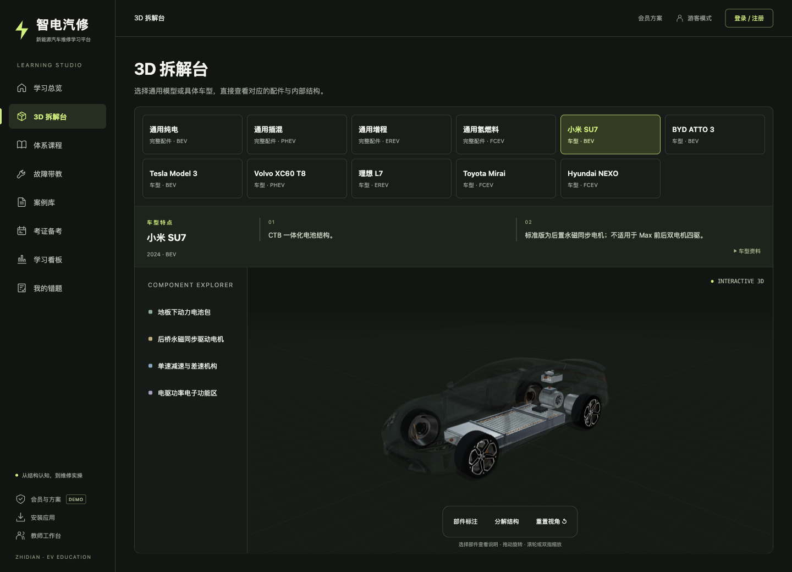

[简体中文](README.md) | **English**

# Zhidian Qixiu Erban

Understand a new-energy vehicle's structure, then practice repairs in virtual scenes. For transitioning combustion-engine technicians and beginners, the platform connects 3D disassembly, component lessons, simulations and AI fault instruction.

[Open the learning platform](http://47.101.135.218/) · [Watch the 15-second introduction](videos/promo-15s.mp4)

## Start with the vehicle, then explore a component

Switch between battery-electric, plug-in hybrid, range-extended or hydrogen fuel-cell vehicles in one 3D studio. Select a component to see its position, description and sources. Open a lesson from the course catalog to work through the theory, quiz and simulation in order.

## Practice what you've learned

Lessons pair quizzes with repair simulations covering high-voltage shutdown, insulation checks, thermal management and related topics. Beginners can follow a structured course, while experienced technicians assess existing knowledge through an advanced track before filling the new-energy gaps.

## Ask about the symptoms in front of you

Start with text, a fault-code photo or a symptom video. AI instruction combines visual recognition, fault-code knowledge and cases to explain diagnostic approaches. Representative questions can become cases for later learning.

## Keep a record of practice

The dashboard collects course progress, game results and mistakes, with theory and image-based certification exercises. Teachers can create classes and review progress to support lessons and follow-up discussions.

## Try it

Enter the student interface through the [live demo](http://47.101.135.218/). The screenshot and course flow above show this branch, which you can run locally using the user guide. Follow vehicle repair procedures and on-site safety requirements for actual repairs.

## Explore further

| Topic | Documentation |
| --- | --- |
| Local startup, teacher portal and model configuration | [User guide](docs/GUIDE.en.md) |
| Courses, vehicles and complete features | [Feature reference (Chinese)](docs/readme-reference.zh-CN.md) |
| Local simulation of enrollment, cancellation and renewal | [Membership demo (Chinese)](docs/membership-demo.md) |
| Source layout, APIs and Windows deployment | [Technical reference (Chinese)](docs/readme-reference.zh-CN.md#五生产部署windows-服务器) |
| Feedback | [Issues](https://github.com/DrivingGodJ/zhidian-qixiu-erban/issues) |

A competition project by the “智电汽修二班” teaching team. [Origins and licensing](docs/GUIDE.en.md#license-and-credits)
