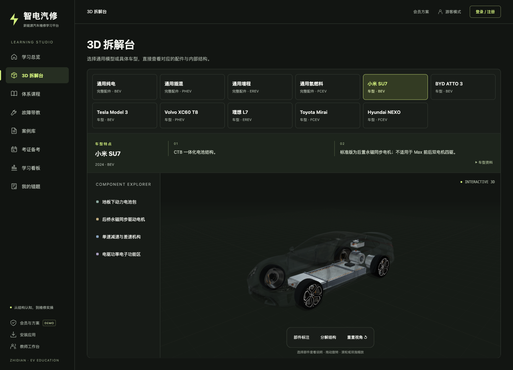

**简体中文** | [English](README.en.md)

# 智电汽修二班

从看懂新能源车的结构，到在虚拟场景中练习维修。面向“油转电”技师和入门学习者，把 3D 拆解、部件课程、实训游戏与 AI 故障带教连成一条学习路径。

[打开教学平台](http://47.101.135.218/) · [观看 15 秒介绍](videos/promo-15s.mp4)

## 先看整车，再走进部件

在同一个三维拆解台切换纯电动、插电混动、增程式或氢燃料电池车型。点击部件查看结构位置、说明与资料来源，再从课程目录进入独立学习页，按顺序完成原理学习、测验与实训。

## 学过的内容，在场景里练一次

课程配合随堂测验和维修实训小游戏，围绕高压下电、绝缘检测、热管理等内容练习。新手可以沿体系课学习，有经验的燃油车技师则通过进阶考核检查已有知识，再补足新能源部分。

## 带着故障现象提问

文字、故障码照片或现象视频都可以成为提问入口。AI 带教结合视觉识别、故障码知识与案例，帮助学习者理解排查思路；典型问题还可以收录为后续学习案例。

## 让练习留下记录

学习看板汇总课程、游戏成绩和错题，考证模块提供理论与看图练习。教师可以创建班级，查看班内学习进度，用同一套平台安排学习和复盘。

## 开始体验

通过[在线演示](http://47.101.135.218/)进入学生端。上方截图与课程流程对应本分支，可按使用指南在本地体验。平台用于学习与模拟，实际维修须遵守实车操作规范和现场安全要求。

## 进一步了解

| 想了解什么 | 去哪里看 |
| --- | --- |
| 本地启动、教师端与模型配置 | [使用指南](docs/GUIDE.zh-CN.md) |
| 课程、车型与完整功能 | [功能参考](docs/readme-reference.zh-CN.md) |
| 本地模拟开通、取消和续费 | [会员演示](docs/membership-demo.md) |
| 目录、API 与 Windows 部署 | [技术与部署参考](docs/readme-reference.zh-CN.md#五生产部署windows-服务器) |
| 问题反馈 | [Issues](https://github.com/DrivingGodJ/zhidian-qixiu-erban/issues) |

“智电汽修二班”教学团队参赛作品。[来源与许可说明](docs/GUIDE.zh-CN.md#许可与致谢)
