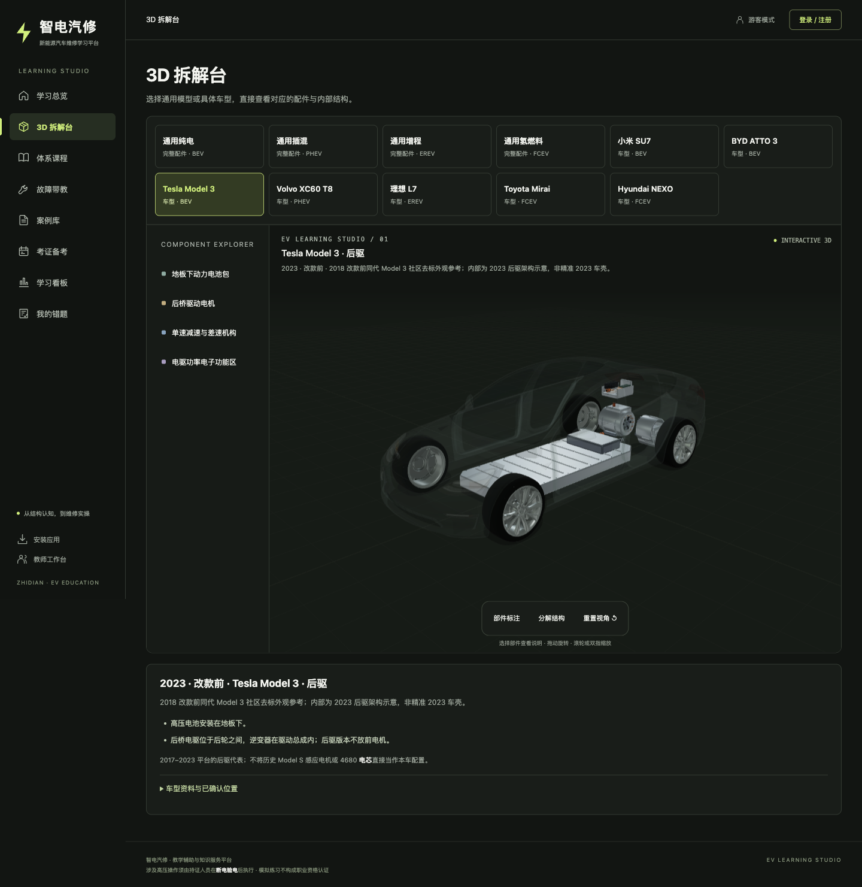

# 智电汽修二班 · 新能源汽车 3D 虚拟维修教学系统

面向燃油车技师「油转电」培训与新能源汽车维修新手教学的一体化 Web 平台。系统以 **3D 整车拆解模型 + 游戏化实训 + AI 故障带教** 为核心，覆盖「结构认知 → 部件原理 → 随堂练习 → 维修实训 → 考证备考」的学习闭环，并内置教师端班级管理功能。

在线演示：http://47.101.135.218/

---

## 一、系统功能总览

### 1. 首页
- 去标车型实时 3D 展示与结构认知、故障诊断、维修实操的学习路径；
- 四大功能入口卡片：3D 拆解台、体系课程、故障带教、案例库。

### 2. 统一 3D 拆解台（`/#models`、`models/`）
- 覆盖 **纯电动（BEV）、插电混动（PHEV）、增程式（EREV）、氢燃料电池（FCEV）** 四种新能源动力形式的整车 3D 模型；
- 四个通用模型和七款具体车型在同一选择区并列，点击后切换同一个画布；点击部件聚焦结构并显示说明及资料来源；
- 3D 看板仅用于观察结构和部件说明；课程从主站目录进入独立学习页面，原理、练习及配套实训在同一课程内顺序完成。

### 3. 故障带教师傅（AI 故障码带教）
- 支持**文字、图片、视频**三种提问方式；
- 上传故障码照片或故障现象视频后，由 **qwen-vl 视觉模型**识别图中故障码/仪表信息；
- AI 结合**本站故障码知识库**（`data.js` 内置的故障码现象、原因、排查步骤、师傅经验）与**维修案例库**，并融合线上知识给出修理建议；
- 典型提问可一键收录进案例库。

### 4. 体系课程
- 目录上方独立列出基础知识与诊断篇章及学习进度，下方按四种动力类型列出部件课程；每章只有一个“开始课程 / 继续课程”入口；
- 课程以部件原理和3D教学示意为主线，每个部件配知识点讲解与随堂练习；
- 每个部件内置 **维修实训游戏**（3D 场景模拟高压安全操作、部件拆装、故障排查等），游戏成绩计入学习看板，错题自动收入错题集。

### 5. 油转电老师傅直通
- 面向有经验的燃油车老师傅的游戏化考核通道：以闯关游戏形式考核新能源三电知识、高压安全规范、故障诊断流程；
- 考核通过即可直通进阶内容，无需从零学起。

### 6. 案例库（`data.js` 内置）
- 按车型/系统/症状分类的真实维修案例：症状 → 排查过程 → 根因 → 修复方案；
- 四大车型均有专属案例与配套游戏，供学员反复演练。

### 7. 考证备考
- **理论题库**：按证书分类的海量练习题，每证 20 道实操向试题；
- **实操看图练习**：结合四大车型 3D 模型与部件图片的实操试题，贴近真实考证场景。

### 8. 学习看板
- 汇总各车型部件课学习进度、游戏成绩、错题集（含游戏错题）、考证备考进度；
- 当前设备的阅读、练习和实训进度按账号保存，保留原云端同步接口；跨设备续学未在本轮验证。

### 9. 教师端（`teacher.html`）
- 教师注册/登录后可**创建班级**，生成班级码；
- 后台查看班级内学生的学习进度、游戏成绩、错题分布；
- **教师申请审核**：新用户提交教师申请后，由持有管理密钥的管理员审核通过，即可开通教师权限。

---

## 二、技术架构

```
┌────────────────────────────────────────────────────┐
│  前端（纯静态，PWA）                                  │
│  index.html / teacher.html / models/*.html          │
│  Three.js 3D 整车模型 · AI 问答前端 · 游戏化实训       │
├────────────────────────────────────────────────────┤
│  后端 server.js（Node.js 18+，零第三方依赖）          │
│  静态托管 · 账号体系(salt+SHA256+HMAC 签名会话)        │
│  进度同步 · 题库接口 · AI 问答代理(DeepSeek/DashScope) │
├────────────────────────────────────────────────────┤
│  数据                                                 │
│  data.js 知识库(故障码/案例/题库) · data/db.json 用户库 │
└────────────────────────────────────────────────────┘
```

- **零依赖后端**：`server.js` 仅使用 Node.js 内置模块（http/fs/crypto），无需 `npm install`，Node 18+ 直接运行；
- **AI 问答**：服务端代理调用阿里云百炼 DashScope（qwen-vl-max 视觉识别）与 DeepSeek（文字问答），Key 只存服务端，前端不接触；
- **视觉识别**：故障码带教支持上传图片/视频，后端转交视觉模型识别后结合本地知识库生成修理建议；
- **PWA**：`sw.js` + `manifest.json`，可「添加到主屏幕」像 App 一样使用；
- **3D**：Three.js（`videos/three.core.js`、`three.module.js`）驱动四大车型整车模型与维修实训游戏场景。

---

## 三、目录结构说明

```
├── index.html          主站统一导航、模型选择与课程目录
├── learn.html          专注学习：原理、练习与实训顺序推进
├── ui/                 共享导航、课程进度、品牌对照及界面样式
├── teacher.html        教师端：班级创建/学生进度/教师申请审核
├── server.js           后端服务：静态托管+账号+进度同步+题库+AI 问答代理（零依赖）
├── cloud.js            前端云端接口封装：登录注册、进度读写、AI 问答调用
├── study.js            学习模块前端逻辑：课程进度、测验交互、看板数据
├── data.js             全站知识库：故障码库、维修案例库、理论/实操题库（单一数据源）
├── lessons.js          体系课课程数据与渲染逻辑
├── sw.js               Service Worker（PWA 离线缓存）
├── manifest.json       PWA 应用清单（位于 videos/ 下，历史部署路径）
├── keys.example.json   服务端密钥配置模板（复制为 keys.json 并填真实值）
├── models/             四种通用布局与具体车型的 3D 模型
│   ├── index.html      旧入口，转向主站 /#models
│   ├── bev.html / phev.html / erev.html / fcev.html   四种动力类型的共享画布页
│   ├── model.js        Three.js 整车渲染、部件拾取与聚焦说明
│   ├── cfg-bev.js / cfg-phev.js / cfg-erev.js / cfg-fcev.js   通用布局配置
│   ├── vehicle-profiles.js / vehicle-component-geometry.js   年款来源与对应结构重建
│   ├── assets/         适配车体模型、许可与署名
│   ├── part.html / detail.js / pdetail.js        部件二级课页面
│   ├── courses.js      部件课程数据（知识点、格式与 BEV 一致）
│   └── quiz.html       部件课随堂测验
├── videos/             教学视频 + 3D 引擎 + 维修实训游戏 + PWA 资源
│   ├── three.core.js / three.module.js           Three.js 引擎
│   ├── nev3d.html / nev3d.js / nev3d.css         纯电动(BEV) 3D 模型页（站点最早的 3D 模块）
│   ├── repair-game.html                          3D 维修实训游戏主程序（各部件游戏共用）
│   ├── v_*.mp4           高压安全/部件/故障排查教学视频（20+ 段）
│   ├── promo-15s.mp4     首页 15 秒宣传片
│   └── app-icon-*.png / app-qr.png / manifest.json   PWA 图标与应用清单
├── vendor/three/       本地 Three.js 补充模块及 MIT 许可
├── scripts/            数据、进度、模型与浏览器回归检查
├── docs/screenshots/   桌面、手机与学习页截图
├── images/             图文教学素材：BMS、高压互锁、线束、热管理、充电、消防等配图
├── data/               运行时数据目录
│   └── db.json         用户账号/进度/班级数据（运行时生成，已 gitignore）
└── .gitignore          排除密钥、用户数据、日志
```

> 说明：`videos/` 目录名继承自早期版本（该目录最初只放视频），现在同时存放 3D 引擎、游戏与 PWA 资源，属于历史兼容路径，请勿重命名（页面引用路径已写死）。

---

## 四、快速开始

### 环境要求
- Node.js 18 或更高版本（无需安装任何 npm 依赖）

### 本地运行
```bash
# 1. 配置密钥（可选：不配也能跑，AI 问答与教师审核停用）
cp keys.example.json keys.json
#   编辑 keys.json 填入 ADMIN_TOKEN 与 AI 接口 Key

# 2. 启动（默认 80 端口，可用 PORT 环境变量修改）
node server.js
```

### 访问
- 学生端：http://localhost/
- 教师端：http://localhost/teacher.html

---

## 五、生产部署（Windows 服务器）

1. 将本仓库解压/克隆到服务器目录（如 `C:\Users\Administrator\Desktop\`）；
2. 在网站根目录外放置 `keys.json`（`server.js` 会优先读取上级目录的 keys.json，防止静态泄露）；
3. 用计划任务保证常驻：
   - **开机自启**：`schtasks /Create /TN DianNengSite /TR "node server.js" /SC ONSTART /RU SYSTEM`
   - **看门狗**：每 5 分钟检查 80 端口，无监听则自动拉起（推荐配合 `watchdog.ps1` 使用）；
4. 云厂商安全组放行 80 端口。

### 服务端 API 概览
| 接口 | 说明 |
|---|---|
| `POST /api/register` / `/api/login` | 账号注册/登录（密码 salt+SHA256 存储，会话 HMAC 签名） |
| `GET /api/progress` / `POST /api/progress` | 学习进度读写（多端同步） |
| `POST /api/ai` | AI 问答代理（文字/图片/视频，服务端拼接知识库后调用视觉/文字模型） |
| `POST /api/admin/apply` | 提交教师申请 |
| `POST /api/admin/review` | 管理员审核教师申请（需 ADMIN_TOKEN） |
| `GET /api/class/progress` | 教师查看班级学生进度 |

---

## 六、安全说明

- **密钥不入库**：`keys.json`（管理令牌、AI 接口 Key）与 `data/db.json`（用户数据）均已加入 `.gitignore`，公开仓库不含任何敏感信息；
- 前端出现的管理令牌用于客户端管理入口，仅作门槛用途；**生产环境请务必修改默认密码**；
- 用户密码以随机盐 + SHA-256 哈希存储，绝不保存明文；
- AI 接口 Key 只存在于服务端环境变量或 keys.json，前端无法获取。

## 七、授权与致谢

本项目为「智电汽修二班」教学团队参赛作品（大学生 AI 创新创业组 / OPC 创新创业 AI Agent 赛道）。
Three.js 遵循 MIT 协议，教学视频与图片素材为本项目自制。

## 2026-10-20 视觉与模型更新

- 四种动力场景共用本地 Three.js 工作台：默认是无品牌完整通用教学布局；另提供按具体年款重建的品牌车型比较。拆解统一显示半透明外壳；四轮对称并落地，内部布局、风扇朝向、编号标注、部件聚焦和分解动画已校正。内部现按下文的具体年款主总成架构展示，尺寸、细部与坐标仍为教学示意，非原厂维修数据。
- 24 类零件共享制造细节与 PBR 材质；50 个维修关卡和 13 类工具统一精修，保留原教学步骤。静态预览合并绘制批次，维修游戏保留独立网格以支持原操作。
- 首页、课程、故障带教、案例、考试、学习看板、教师和部件页面采用石墨灰与青柠视觉体系，补齐手机导航、焦点与减少动效支持。
- 无新增 npm 运行依赖。Three.js 补充模块存放在 `vendor/three/`；模型作者、许可和修改说明见 `models/assets/ATTRIBUTION.md`。发布时请保留署名。

本地预览（Node.js 18+）：

```sh
PORT=8088 node server.js
```

浏览器访问 `http://localhost:8088/`。原有账号/数据/AI 配置继续使用；图像与联网 AI 需要原配置中的服务端 Key，本次未添加或改动密钥。

验证：

```sh
node scripts/verify-assets.mjs
node scripts/verify-models.mjs
node scripts/verify-ui-data.cjs
node scripts/verify-ui-focus.cjs
```

`videos/nev3d.js` 是上游提供的编译产物；其中整车与单部件场景通过小型桥接复用可编辑的 `models/model.js` / `component.js`，保留原部件课程、题目和游戏入口。此改造未部署到原在线演示服务器；公开源码或提交 PR 不会自动更新该演示站点。

### 本轮交互简化

- `/#models` 在主站内并列选择通用模型与具体车型，不离开侧栏导航；点部件只查看说明。旧 `/models/index.html` 自动回到此看板。
- `/#course` 直接列出部件课程；点“开始课程”才进入独立专注页面。学习页只有一条返回入口，清理重复跳转、旧站推广和误标“实拍”的文案。
- 安装页识别 macOS、Windows、Linux、Android、iPhone、iPad，提供手动指引切换；各平台均可使用网页版，未提供虚构原生安装包。
- 复查主站九个分区的桌面、平板、手机布局，以及学习、练习和实训之间的返回路径。

验证：`node scripts/verify-assets.mjs`、`node scripts/verify-models.mjs`、`node scripts/verify-layouts.mjs`、`node scripts/verify-ui-data.cjs`；交互验证见 `scripts/verify-ui-focus.cjs`。

### 统一课程学习流程

主站课程按四种动力类型分组，共 53 个核心部件章节，保留 35 条基础与诊断课程。所有课程统一进入 `learn.html?vehicle=bev&part=motor` 或 `learn.html?vehicle=bev&lesson=1`，按原理、练习、实训、结果推进；没有实训的基础课直接到结果。

新学习页面直接复用原始部件资料与题目，避免旧学习页、练习目录、实训目录之间反复跳转。实训嵌入同一课程，画布、工序信息、工具栏与课程底栏分别占据独立区域；旧链接自动转向新入口。当前设备进度按账号保存；错题及原有进度记录继续使用。

验证增加：`node scripts/verify-learning-data.cjs`。已真实走完驱动电机课程的 10 道练习、两项维修实训及结果页；另检查 PHEV、EREV、FCEV 实训嵌入与车型返回上下文。

### 基础课程、进度与实训解锁

- 课程目录上方单独展示 35 章基础与诊断课程，分五篇显示总进度、篇进度和章状态；下方是四种车型的 53 个部件章节。目录、学习页和学习看板共用 `ui/course-progress.js`。
- 相关基础课内嵌 3D 整车或部件对照，不离开当前课程。模型默认允许页面继续滚动，点“操作模型”后才接管拖动。章节内容、模型、操作和底栏分别排布。
- 阅读至末尾并完成本课全部练习、查看练习结果后，才解锁对应车型与部件的实训。案例保留一个对应课程入口；旧实训地址和嵌入实训也检查前置进度，跳转参数和旧星级不能解锁。
- 阅读位置、作答、学习完成和真实实训结果按当前设备账号分别保存；基础知识跨车型共用，部件课按车型区分。演示不算真实实训完成。旧基础课记录兼容读取；旧实训星级仅作为独立历史展示。
- 本轮未验证跨设备同步；未添加依赖或改动题目答案。实训仍为通用结构教学示意。

验证增加：`node scripts/verify-course-progress.cjs`。实际浏览器验证阅读和中途作答刷新续学、完整练习解锁、真实维修操作后的保存、直接地址拦截，以及手机布局。

`node scripts/verify-training-gates.cjs` 进一步验证直接实训与嵌入实训的前置条件、真实结果保存失败重试，以及操作途中切换账号的结果隔离。`node scripts/verify-learning-persistence.cjs` 验证同一课程多标签保存不会覆盖已完成的学习与真实实训记录。

### 品牌结构对照与建模精修

- 删除基础课程顶部的入门导览。切换课程车型只刷新车型目录，保留基础篇展开状态与滚动位置；与整页导航分别处理。
- 基础课 1/3/7/27/50 保留原整车布局对照，可在原位切换到品牌部件比较；不离开课程。
- 品牌学习在当前原理页完成：左右选择品牌方案、查看真实不同的结构模型，再阅读对照要点、品牌介绍及对应资料。一次最多两个模型，手机上下排列；相关课程不再重复加载额外通用预览。
- 新增 12 种公开架构参考：Blade、麒麟 CTP 3.0、4680、电驱八合一、历史感应电驱、DriveONE 七合一、DM-i EHS、THS、Octovalve、DENSO 热泵、第二代 Mirai 与 2018 代 NEXO。电池阵列、转子、齿轮、阀组和电堆采用不同几何；均为教学示意，不是原厂 CAD。
- 恢复原五组品牌资料的电池、电驱、集成、维修和诊断主题。完整旧记录保存在 `ui/brand-comparisons.js` 用于追溯，展示稿按官方资料限定车型、年份和架构，避免把 4680、48V、800V、CTB 或换电概括成品牌全系配置。
- 13 类维修工具重做工作头与握持结构，补齐表笔、线缆、软管、棘轮、开口、空心喷口等；通用零件优化壳体圆角、剖面、绕组、端接与工程材质。场景布局、关卡原工序与学习进度机制保留。
- 部件预览按实际宽高取景，离屏暂停绘制；共享细节贴图与静态合批控制绘制成本。

新增检查：`node scripts/verify-component-variants.mjs`、`node scripts/verify-brand-learning.mjs`。浏览器检查复用已分配的 Ego Lite 工作空间，显式传入 `UI_QA_SPACE` 与 `UI_QA_PAGE`，不会自行创建或操作旧空间。


### 通用整车与品牌车型对比

- `/#models` 在同一个选择区并列展示四种通用模型和七款品牌车型，点击后直接切换同一个画布，不设单独车型对比模式。默认通用纯电模型；四种通用动力形式各自显示完整配件集合，合计 53 个内部总成，使用无品牌车体。通用车身课程的名称、正文、框架标题与实际模型均不再套用 SU7 名称或车体。
- 拆解台的具体车型与通用模型共用选择区、画布和部件树；下方资料随当前模型更新。相关基础课 1/3/7/27/50 默认通用整车观察，选择器分组列出通用四种与品牌七款；第50课保持原 FCEV 对照。原12种品牌部件结构比较继续保留。
- `models/generic-profiles.js` 管理通用标签。没有 profile 参数或 `profile=generic-bev` 等通用参数时，`models/model.js` 使用原完整 `cfg-*` 配件。显式 `profile=su7-rwd-2024` 等品牌参数时使用 `models/vehicle-profiles.js` 的具体年款数据，并强制从 `models/vehicle-component-geometry.js` 的专属几何获取每件总成；不回退为通用整件。
- 七款代表包括2024 SU7标准后驱、2022–2023 ATTO 3前驱、2023改款前Model 3后驱、2022升级后XC60 T8 Extended Range、2023理想L7、第二代Mirai与第一代NEXO。36个对应主总成分别重建电芯形态、电驱集成、永磁电机、ERAD、增程器、电堆、储氢形式与缓冲电池。Model 3包体封闭展示，不擅自指定未核实的电芯/供应商；具体几何依公开资料重建，非原厂CAD。
- SU7、XC60与新增的改款前Model 3使用可授权社区真实车型外观。Model 3外壳是2018同代参考，内部代表2023后驱，边界就近注明。其余四款未取得适用的可复用源文件，继续明确标注无品牌通用车体；查找结果见 `models/vehicle-shell-assets.js`。作者、许可与去标/对称轮位等修改见 `models/assets/ATTRIBUTION.md`。
- 统一轴距框架用于关系对照，不用于量产尺寸或维修间隙比较。资料、年款、外观范围与来源就近展示；未核实的小型控制器及线路不随意定位。拆解台始终保留一个模型画布，重复点击当前模型不重新加载；学习章节的双模型对照继续保留，切换时保持阅读位置与学习记录。

新增检查：`node scripts/verify-vehicle-profiles.mjs`，覆盖七车36个专属总成的独立几何、来源引用、合批后身份、离地与包络、轴向、驱动桥数量、氢罐拓扑及相交；`UI_QA_SPACE=<已分配工作空间> UI_QA_PAGE=p2 node scripts/verify-brand-learning.mjs`验证完整通用模型、专属品牌几何实际加载、拆解台单画布切换、学习页双模型对照、学习记录、手机排布与清理。

### 界面截图

| 统一拆解台（桌面） | 手机模型选择 | 课程原理与3D观察 |
| --- | --- | --- |
| [查看大图](docs/screenshots/studio-desktop.png) | [查看大图](docs/screenshots/studio-mobile.png) | [查看大图](docs/screenshots/learning.png) |


